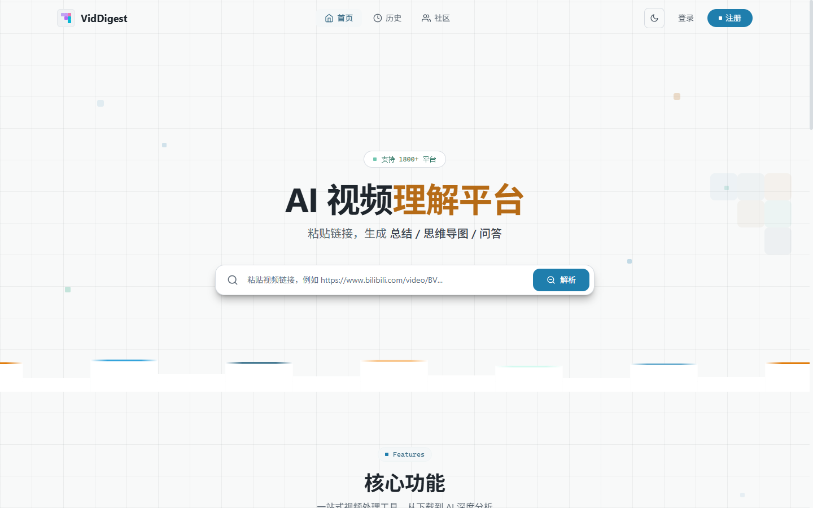
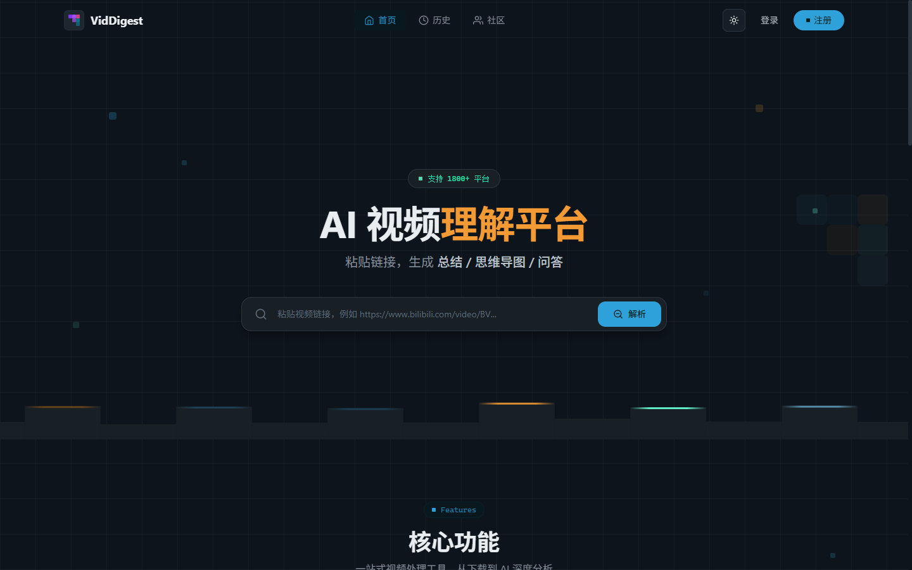
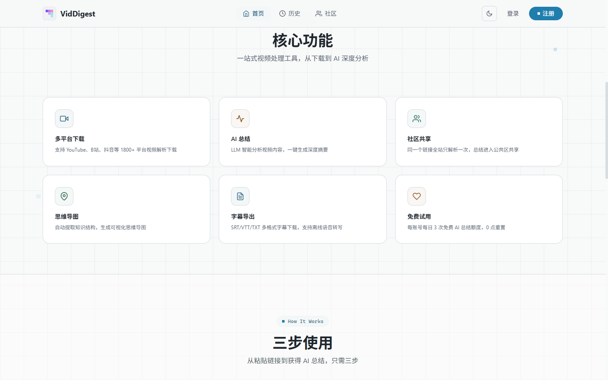

<p align="center">
  <picture>
    <source media="(prefers-color-scheme: dark)" srcset="https://img.shields.io/badge/VidDigest-AI%20视频理解与下载平台-7c3aed?style=for-the-badge&logo=github">
    
  </picture>
</p>

<p align="center">
  <b>English</b> · <a href="README.md">中文</a>
</p>

<p align="center">
  <a href="#-what-it-does">What it does</a> ·
  <a href="#-quick-start">Quick start</a> ·
  <a href="#-usage">Usage</a> ·
  <a href="#-architecture">Architecture</a> ·
  <a href="#-testing--verification">Testing</a> ·
  <a href="#-configuration">Configuration</a> ·
  <a href="#-documentation">Documentation</a> ·
  <a href="#-design-decisions">Decisions</a>
</p>

<p align="center">
  
  
  
  
  
</p>

---

<p align="center">
  <b>VidDigest</b> is a full-stack video understanding and download platform built on
  <b>yt-dlp + LLM</b>. Paste a link and you get an <b>AI summary, a mind map and AI Q&amp;A</b>;
  download from <b>1800+</b> video platforms in the same flow.
</p>

> This file is the English entry point. [README.md](README.md) is the primary document and
> carries the same content in Chinese.

---

## ✨ What it does

| Feature | Description | Free tier |
|--------|-------------|:--------:|
| 🧠 **AI summary** | The LLM analyses the subtitles and produces a structured summary; four templates to choose from (full / brief / tutorial / analysis) | 3 per day |
| 🗺️ **Mind map** | An interactive, zoomable mind map extracted from the video's knowledge structure (at most 3 levels, 7 branches per level, 30 nodes in total) | Shared with the summary |
| 💬 **AI Q&amp;A** | Ask follow-up questions about the video, answered from its content | 10 per day |
| 📝 **Subtitle export** | Extract and export subtitles as SRT / TXT | Included |
| 🎬 **Parse &amp; download** | YouTube, Bilibili, Douyin and 1800+ other platforms, pick a quality and download | ✅ Unlimited |
| 🎧 **Audio-only download** | Pick a native audio container (e.g. m4a / webm-opus / mp3) when you only need the sound — no transcoding | ✅ Unlimited |
| 🗂️ **Community** | Read summaries, subtitles and mind maps other people already generated | ✅ Free |
| 🕘 **Parse history** | Search, tag and favourite your own parse records | ✅ |
| 🛠️ **Admin console** | Quota management, admin flags, account create/delete, community entries and tag vocabulary, model catalogue | Admins only |
| 🎟️ **Invite-code console** | Issue and revoke invite codes in batches; the plaintext code is shown once, at creation (`/admin/invite-codes`) | Admins only |
| 🛡️ **Abuse controls** | Public endpoints are rate-limited per source IP; heavy endpoints also have a concurrency gate (2 by default) | ✅ |

> Parsing and downloading do not require an account; the AI features do.
> **Registration needs an invite code — get one from an administrator.**
> The free tier is
> **two independent counters**: 3 parses per day (a parse yields summary + mind map + tags)
> and 10 follow-up questions per day. Reading the community consumes neither. The numbers
> come from `VIDDIGEST_DAILY_PARSE_LIMIT` / `VIDDIGEST_DAILY_CHAT_LIMIT`.

---

## 🖼️ Interface preview

<table>
  <tr>
    <td width="50%" align="center"><br><sub>Home</sub></td>
    <td width="50%" align="center"><br><sub>Dark theme</sub></td>
  </tr>
</table>

<p align="center">
  
</p>

> Screenshots are taken from the current version running locally via `docker compose up -d --build` (1440×900).

---

## 📦 Requirements

| Tool | Minimum | Used for |
|------|:--------:|----------|
| Python | 3.11+ | Backend (developed and tested on 3.11.9) |
| Node.js | 20.19+ or 22.12+ | Frontend build — a hard requirement of Vite 8 (**Node 18 cannot install it**) |
| npm | 10+ | Frontend dependencies |
| ffmpeg | any | Merging separate video and audio streams (strongly recommended) |

> **ffmpeg** merges the video and audio streams that DASH sources (Bilibili, YouTube) ship
> separately. Without it the downloader falls back to a single stream.
> Windows: [ffmpeg.org](https://ffmpeg.org/download.html) → add `bin` to PATH ·
> macOS: `brew install ffmpeg` · Linux: `sudo apt install ffmpeg`

---

## 🚀 Quick start

> 💡 One command sets up both stacks: `bash scripts/bootstrap.sh` — it creates
> `backend/venv`, installs the backend requirements and runs `npm ci` in `frontend/`.

```bash
# Backend (Windows; Linux/macOS below)
cd backend
python -m venv venv
venv\Scripts\python.exe -m pip install -r requirements.txt
copy .env.example .env                # fill in your keys (see Configuration)
venv\Scripts\python.exe main.py       # → http://localhost:8000

# Frontend (another terminal)
cd frontend
npm install
npm run dev                           # → http://localhost:5173
```

```bash
# Backend on Linux / macOS
cd backend
python3 -m venv venv
source venv/bin/activate              # bin/activate, not Scripts/
pip install -r requirements.txt
cp .env.example .env
python main.py
```

> ⚠️ **Always run the backend with the venv interpreter** (`venv\Scripts\python.exe` on
> Windows, `venv/bin/python` on Linux/macOS). A bare `python main.py` uses the system
> interpreter, where the dependencies are not installed.
>
> ⚠️ Use `localhost`, not `127.0.0.1`, for the frontend: Vite listens on the IPv6 loopback
> only, so `127.0.0.1:5173` does not connect.

Open **http://localhost:5173**, paste a video link, then parse / summarise / download.

> Restart the backend after editing Python code — `main.py` runs Uvicorn without `--reload`.

### 🐳 Or run it with Docker

The repo ships a `docker-compose.yml`; one command starts both stacks (the backend
reads its secrets from `backend/.env` via `env_file`; no secret ever enters the image):

```bash
docker compose up -d --build
curl http://127.0.0.1:8000/api/health     # → {"status":"ok"}
# Frontend entry point: http://127.0.0.1:8080
# The frontend port proxies /api/ to the same backend, health check included:
#   http://127.0.0.1:8080/api/health
docker compose down                       # stop and remove the containers
```

> Stopping the containers **keeps the data**: `backend/data` and `backend/logs` are bind
> mounts, so the SQLite file stays on the host and the container sees the same copy.

---

## 📖 Usage

### Parse &amp; download

```
① open the home page → paste a video link → ② click "Parse"
③ pick a quality under "选择画质", or an audio container under "纯音频"
④ click "下载视频" / "下载音频"
```

Audio-only downloads ship the platform's **native audio containers** (e.g. m4a / webm-opus /
mp3); nothing is transcoded.

### AI summary

Sign in, parse a video, then open the "AI 总结" tab and pick a template. The panel has
four tabs: a streamed **summary**, an interactive **mind map** (markmap; up to 3 levels,
7 branches per level, 30 nodes in total), the raw **subtitles**, and **Q&amp;A**.

| Template | What it is for |
|----------|----------------|
| **Detailed summary** (`full`) | The full analysis: a thorough summary, mind map and tags |
| **Brief** (`brief`) | Only the key conclusions — one screen, to decide whether the video is worth it |
| **Tutorial** (`tutorial`) | The content turned into steps you can follow, with prerequisites and caveats |
| **Analysis** (`analysis`) | Claims, arguments and counterpoints, with a conclusion you can carry over |

### Registration and invite codes

Registration is **invite-code only**: the endpoint requires a valid code, and codes are
issued by administrators (admin console → invite codes). A code carries a number of uses
and an expiry; validating the code, creating the account and decrementing the use count
happen in one transaction, so a failed registration does not consume the code.

---

## 🏗️ Architecture

```
browser (Vue 3 + Vite)
  │  relative /api calls — same origin in dev (Vite proxy) and in production (Nginx)
  ▼
FastAPI (Uvicorn)                     44 REST endpoints, 32 of them behind an auth dependency (3 take an optional token)
  ├─ api_auth / api_history / api_community / api_payment / admin_api
  ├─ api_summarize ──► SSE streaming (text/event-stream) for summary and Q&A
  ├─ downloader / douyin ──► yt-dlp and a dedicated Douyin module
  ├─ summarizer ──► LLM calls (OpenAI-compatible or Anthropic protocol)
  └─ database ──► SQLite via the Python standard library (WAL mode)
```

| Layer | Technology | Notes |
|:----:|-----------|-------|
| Frontend | Vue 3 + Vite + Tailwind CSS 4 | SPA, streaming rendering, two test runners |
| Backend | FastAPI + Uvicorn | REST API plus SSE for the AI features |
| Video parsing | yt-dlp + a dedicated Douyin module | 1800+ platforms; parsing is **not** re-implemented here |
| AI | OpenAI-compatible / Anthropic protocols (Alibaba Bailian today) | Summary, mind map, tags, Q&A |
| ASR fallback | Whisper API | Only when a video has no subtitle track |
| Auth | JWT + bcrypt | Token lifetime 72 h; admin rights are re-read from the database per request |
| Database | SQLite (standard library, WAL) | Users and quotas, orders, community videos, parse history, chat sessions |

Design decisions worth reading are recorded as ADRs — see [Design decisions](#-design-decisions).
Two examples that shape most of the code:

- **ADR 0006** — the first parse of a video wins: a unique index arbitrates concurrent
  parses of the same URL, so a video is never parsed twice and never billed twice.
- **ADR 0004** — a user-supplied API key (BYOK) is forwarded to the provider for that
  request only; it is never written to the database.

---

## ✅ Testing &amp; verification

The repository has a single gate. It is the only thing that decides whether a change is
allowed to be called done:

```bash
bash ./init.sh          # exit code 0 = verified
```

| # | Check | What it proves |
|---|-------|----------------|
| 1 | `backend: pytest` | All backend tests pass (pytest, standard-library sqlite fixtures) |
| 2 | `backend: compileall` | Every backend module compiles |
| 3 | `secrets: content-level scan` | No credential-shaped string in tracked files **or in reachable git history** — `.gitignore` is filename-level and does not stop a pasted key |
| 4 | `frontend: npm test` | All static / contract assertions pass (node:test) |
| 5 | `frontend: npm run test:mount` | 215 mounted-component tests (Vitest) — a separate runner on purpose, so a green layer cannot hide a red one |
| 6 | `frontend: npm run typecheck` | `vue-tsc --noEmit` reports no type errors |
| 7 | `frontend: npm run lint` | ESLint reports no problems |
| 8 | `frontend: npm run format:check` | Every file matches Prettier |
| 9 | `refs: ADR 与路径引用一致性` | Every `ADR NNNN` reference and every source path mentioned in docs or comments still resolves |
| 10 | `gate: 关卡数口径一致性` | The number of checks this README claims is the number the gate really runs — counted from `init.sh`, never hard-coded |
| 11 | `eval: 社区检索质量` | Community search: structural checks (indexed columns, the three sync triggers, tokenizer) plus top-1 accuracy, body-word recall, two-character recall and zero false hits on a fixed corpus |

Two properties make the gate trustworthy rather than decorative:

- **Mutation testing.** 24 mutation scripts deliberately break one invariant at a time
  (auth boundary, canonical URLs, database fixtures, payment webhooks, secret scanning,
  the community search index …) and assert that the gate turns red. A check that never turns red is not a check.
- **The gate checks itself.** Checks 6 and 7 exist because the instructions, the ADRs,
  the test strategy and the source comments point at each other, and a stale pointer
  turns no test red — it just keeps constraining the next reader. One real instance:
  a source comment referenced the wrong ADR, and nothing noticed for a long time.

```bash
# one mutation script, e.g. the secret-scan gate
./backend/venv/Scripts/python.exe scripts/mutation_secrets_gate.py
```

Further reading: [docs/TESTING-STRATEGY.md](docs/TESTING-STRATEGY.md) (strategy, coverage
gaps, mutation harness) and [docs/OPERATIONS.md](docs/OPERATIONS.md) (runtime facts).

---

## ⚙️ Configuration

Copy `backend/.env.example` to `backend/.env`. The template annotates every entry; this
section explains **what is required and what breaks if you get it wrong**.

### AI services (no key ⇒ no AI features; parsing and downloading keep working)

The platform model (summaries, mind maps, tags, follow-up chat) goes through **one**
provider. Its credential, endpoint and model all come from environment variables:

| Variable | Purpose | Where to get it | If missing |
|----------|---------|-----------------|------------|
| `ALIYUN_BAILIAN_API_KEY` | **Required**: the platform model's credential (Alibaba Bailian, OpenAI-compatible mode) | [bailian.console.aliyun.com](https://bailian.console.aliyun.com/) → API-KEY management | The AI features raise an error — the platform side has **no fallback provider** (see "Provider configuration" below) |
| `ALIYUN_BAILIAN_BASE_URL` | Endpoint, defaults to `https://dashscope.aliyuncs.com/compatible-mode/v1` | The workspace-specific address from the Bailian console | The default is used |
| `ALIYUN_BAILIAN_MODEL` | Model; **leave it empty to take `bailian.default_model` from the model catalog** (currently `qwen3.7-flash`) | Same as above | The catalog value is used |
| `ALIYUN_BAILIAN_PROTOCOL` | Protocol: `openai` (default) or `anthropic` | — | `openai` |
| `ALIYUN_BAILIAN_ENABLE_THINKING` | Thinking switch, **off** by default | — | Off |
| `OPENAI_API_KEY` | **Whisper ASR only**: transcribes audio when a video has no subtitles | [platform.openai.com](https://platform.openai.com/) | ASR is skipped; nothing else is affected |

> **Environment variables win over the model catalog.** As soon as
> `ALIYUN_BAILIAN_MODEL` is set, it overrides the catalog's platform default; leave it
> empty to use the catalog's `qwen3.7-flash`.

> The platform side has **no fallback provider**: without `ALIYUN_BAILIAN_API_KEY` the
> process still starts — parsing and downloading keep working — and the first AI call
> returns 500 naming the variable to set, instead of silently degrading to another
> provider. See [ADR 0028](docs/adr/0028-platform-model-and-provider-protocols.md)
> for why: a fallback chain hides the first provider's real error.

With a user-supplied credential (BYOK), the platform key is not used at all.

### 🧩 Provider configuration

The platform model talks to **one** provider, and that provider is four things:
**protocol + endpoint + model + key**. All four come from environment variables
(nothing is stored in the database or in the repository):

| Part | Variable | Value |
|------|----------|-------|
| Protocol | `ALIYUN_BAILIAN_PROTOCOL` | `openai` (default, OpenAI-compatible) or `anthropic` (Anthropic Messages API) |
| Endpoint | `ALIYUN_BAILIAN_BASE_URL` | OpenAI-compatible takes a **prefix** (`.../compatible-mode/v1`); Anthropic takes the **root** (`https://api.anthropic.com` — a trailing `/v1` is not doubled into `/v1/v1/messages`) |
| Model | `ALIYUN_BAILIAN_MODEL` | Empty = the catalog's platform default (currently `qwen3.7-flash`) |
| Key | `ALIYUN_BAILIAN_API_KEY` | The provider's credential |

Both protocols are supported; **only Bailian is configured today** (OpenAI-compatible
mode). The Anthropic path is a hand-written adapter on top of the `requests` package
already in this repository (POST `/v1/messages` + `x-api-key` + `anthropic-version` +
an SSE stream) — no anthropic SDK is installed.

**Platform model vs. user-supplied credential (BYOK)**: BYOK is the **user's own**
key and endpoint and only affects that user's own call; the platform model is the
**service's** key driving the catalog's default model. The two never interact, and
BYOK is not a way to switch providers.

> **Never commit a key.** The real value lives in `backend/.env` (blocked by
> `.gitignore`); but `.gitignore` blocks a file, not "someone pasting the secret into
> a document", so gate 4 (`scripts/check_secrets.py`) also scans the working tree and
> every reachable git history. The template `backend/.env.example` deliberately keeps
> no concrete credential string.

**Switching providers means editing environment variables and restarting**: protocol
and endpoint are read once at startup.

### The other required entry

| Variable | Purpose | If missing |
|----------|---------|------------|
| `JWT_SECRET` | Token signing key — **required, no fallback** (ADR 0010) | The process refuses to start at import time rather than falling back to something guessable |
| `VIDDIGEST_ALLOWED_ORIGINS` | Explicit CORS allow-list, comma-separated; empty means no cross-origin access at all (the default) | Same-origin frontend access is unaffected |
| `VIDDIGEST_ADMIN_EMAILS` | Comma-separated list of accounts seeded as admins | Nobody is an admin |
| `VIDDIGEST_DAILY_PARSE_LIMIT` / `VIDDIGEST_DAILY_CHAT_LIMIT` | Daily free quotas, 3 / 10 by default, counted separately and reset at midnight (UTC) | The defaults are used; changing them changes the **default only**, it never resets what a user already spent |

Generate a JWT secret:

```bash
openssl rand -hex 32
```

### Payments (currently disabled)

`STRIPE_SECRET_KEY` / `STRIPE_WEBHOOK_SECRET` / `STRIPE_PRICE_ID_MONTHLY` are kept as
configuration slots only: the project does not do memberships, so filling them changes
nothing.

> **Real values live in `backend/.env` and nowhere else.** It is covered by `.gitignore`,
> but `.gitignore` is **filename-level** — it stops the file, not somebody pasting a
> password into the docs. That is why this repo also runs a content-level scan
> (`scripts/check_secrets.py`, gate check 4) over the worktree and every reachable git
> history. The template `backend/.env.example` deliberately keeps **no concrete credential**
> in it (not even a sample password) — generate the value instead.

> Without an LLM key, parsing and downloading still work; the AI features do not.

Full variable list and how changes take effect: [docs/OPERATIONS.md §4](docs/OPERATIONS.md).
Annotated template: [backend/.env.example](backend/.env.example).

---

## 📖 Documentation

| Document | Contents |
|----------|----------|
| [docs/API.md](docs/API.md) | Complete endpoint list with auth requirements |
| [docs/OPERATIONS.md](docs/OPERATIONS.md) | Runtime facts, deployment, static hosting, monitoring points |
| [docs/TESTING-STRATEGY.md](docs/TESTING-STRATEGY.md) | Test strategy, coverage gaps, mutation harness |
| [docs/INVITE-CODES.md](docs/INVITE-CODES.md) | Invite-code semantics: issuing, consuming, revoking |
| [docs/TECHNICAL.md](docs/TECHNICAL.md) | End-to-end walkthrough of the AI pipeline (Chinese) |
| [docs/AI功能核心技术说明.md](docs/AI功能核心技术说明.md) | How the AI pipeline works (Chinese) |
| [GLOSSARY.md](GLOSSARY.md) | Domain vocabulary |
| [docs/adr/](docs/adr/) | Architecture decision records |

---

## 🧭 Design decisions

Each ADR records a decision that was hard to reverse, surprising without context, and the
result of a real trade-off.

| ADR | Decision |
|-----|----------|
| 0001 | Community videos live in their own global table, not in personal parse history |
| 0002 | Subtitle text is stored together with the community video |
| 0003 | Parse quota and chat quota are separate counters |
| 0004 | A user-supplied API key is forwarded by the server but never stored |
| 0005 | Tags come from a hand-maintained fixed vocabulary; the model may not invent them |
| 0006 | The first parse of a video wins — no overwrite, no double billing |
| 0007 | The owner of a parse may regenerate their own summary; later visitors may not |
| 0008 | Visual identity: graphite + lake blue |
| 0009 | Light and dark themes override CSS variables instead of introducing semantic tokens |
| 0010 | The admin console is an `/admin` route in the same Vue app — scope and authentication |
| 0011 | The model catalogue lives in the database; platform and user keys stay in `.env` |
| 0012 | Account lifecycle moves into the admin console: create, flag as admin, delete (409 when content exists) |
| 0013 | Community moderation: retag and delete entries — deleting the community row only, never a user's history |
| 0014 | Card display fields are written at reservation time, not back-filled by the frontend |
| 0015 | The regeneration gate is stored in the database instead of assuming a single backend process |
| 0016 | URL canonicalisation: compare by canonical form, echo the original |
| 0018 | Front-end routing uses `vue-router` with real paths |
| 0019 | Containerised delivery: two services, one compose file, scripts that operate on the running data |
| 0020 | Public endpoints are rate-limited per source IP (429 + `Retry-After`) |
| 0021 | Public endpoints have a concurrency gate, working alongside the rate limit |
| 0022 | Client identity behind a reverse proxy: the edge overwrites `X-Forwarded-For`, the backend takes its last segment |
| 0023 | Registration requires an invite code |
| 0025 | The invite-code console is its own route (`/admin/invite-codes`) |
| 0026 | The summary-template catalogue has a single source; template ids cross the seam explicitly |
| 0027 | The mind map has a fixed three-level structure; stored maps are rebuilt by a write migration |
| 0028 | One platform model (`qwen3.7-flash`), providers configured by protocol, no fallback chain |
| 0029 | The mind-map structure has one source of truth; the legacy rebuild also drops rows that exceed the limits |
| 0030 | Community search indexes the body (summary and subtitle); two-character queries fall back to a bounded substring match |

---

## 🛟 FAQ

<details>
<summary><b>Parsing fails?</b></summary>

- **"Cannot parse this link"** → `pip install --upgrade yt-dlp`
- **Download has no sound** → install ffmpeg
- **Douyin fails** → make sure you paste the short share link, then retry
</details>

<details>
<summary><b>AI summary does not work?</b></summary>

- **"No subtitles available"** → the video has no subtitle track, so it cannot be summarised
- **"Daily limit reached"** → 3 per account per day, reset at midnight
- **"Please sign in first"** → register or sign in to use the AI features
- **No response** → check the LLM key in `.env` (`ALIYUN_BAILIAN_API_KEY`; the platform side has no fallback provider)
</details>

<details>
<summary><b>Cannot register?</b></summary>

- **"Invite code invalid / already used"** → registration needs an invite code, get one
  from an administrator. A code has a number of uses and an expiry; once it is used up or
  expired you need a new one.
- **"Email already registered"** → sign in instead, or use another address.
</details>

<details>
<summary><b>429 / too many requests?</b></summary>

- Public endpoints are rate-limited per source IP (20 parses, 10 downloads, 30 direct-url
  lookups per minute, …), and parsing and downloading also have a concurrency gate (2 at
  a time by default). Retry after a short wait.
</details>

<details>
<summary><b>Database questions</b></summary>

```bash
# reset the database (removes all users and orders)
rm -f backend/data/app.db          # rebuilt automatically on the next start

# inspect it
sqlite3 backend/data/app.db "SELECT * FROM users;"
```
</details>

---

## 🤝 Contributing

Issues and pull requests are welcome. The engineering conventions live in
[AGENTS.md](AGENTS.md); the gate is `./init.sh`.

## 📄 License

[MIT](LICENSE)

---

<p align="center">
  <sub>Built with Vue 3 + FastAPI + yt-dlp + LLM</sub>
</p>
